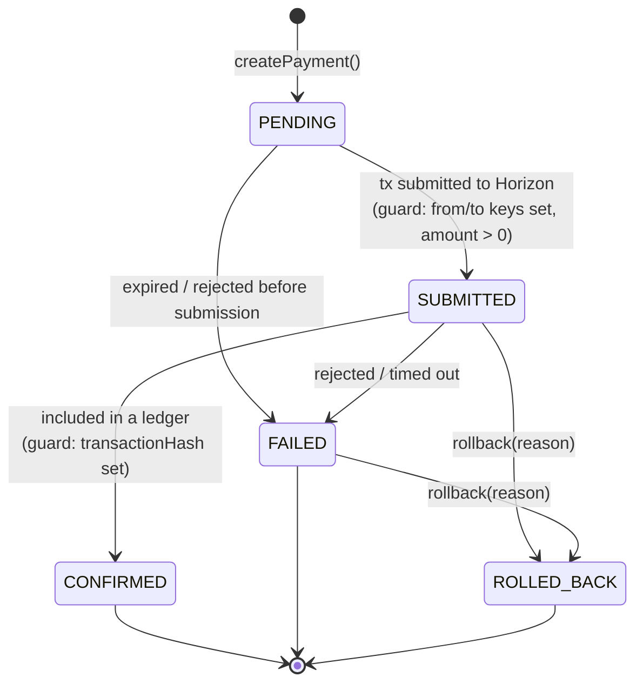
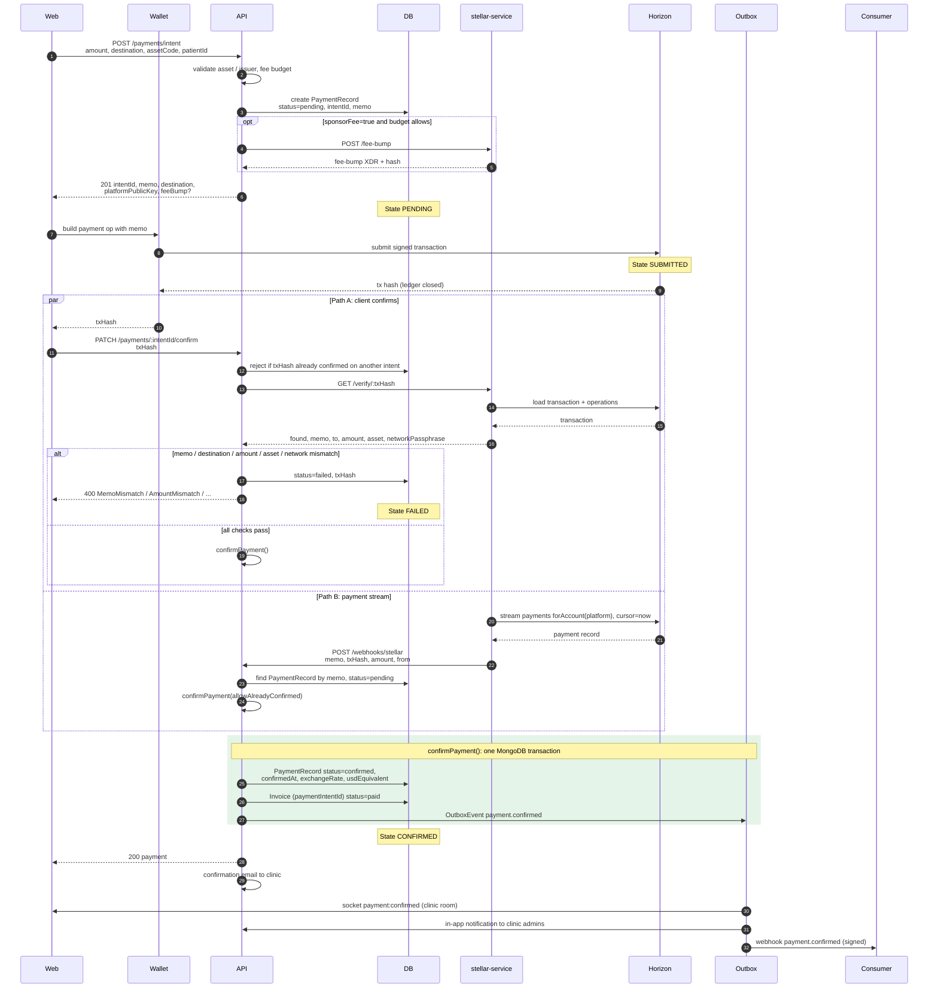
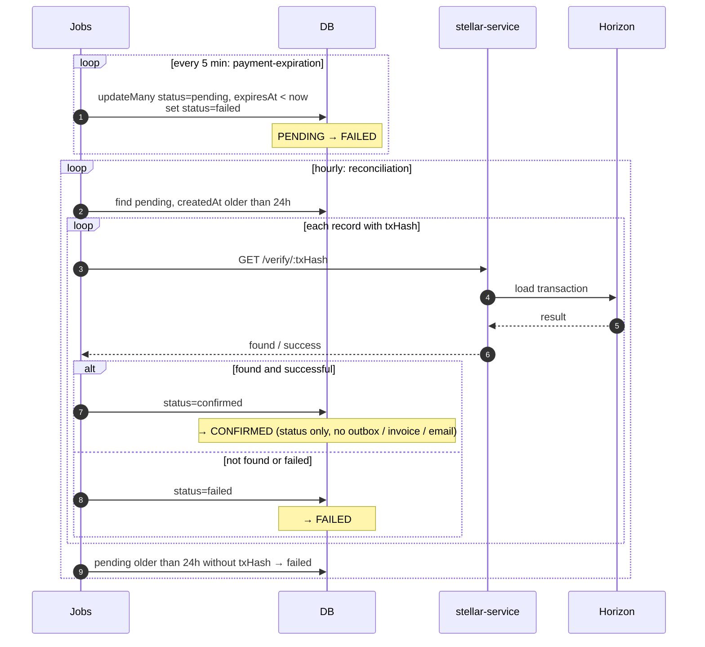
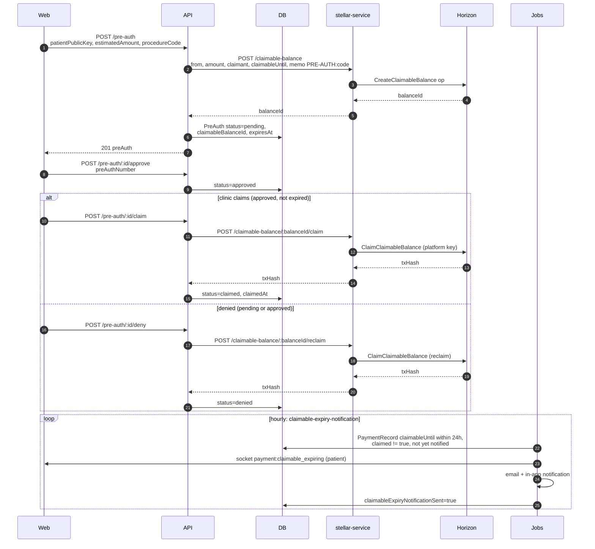
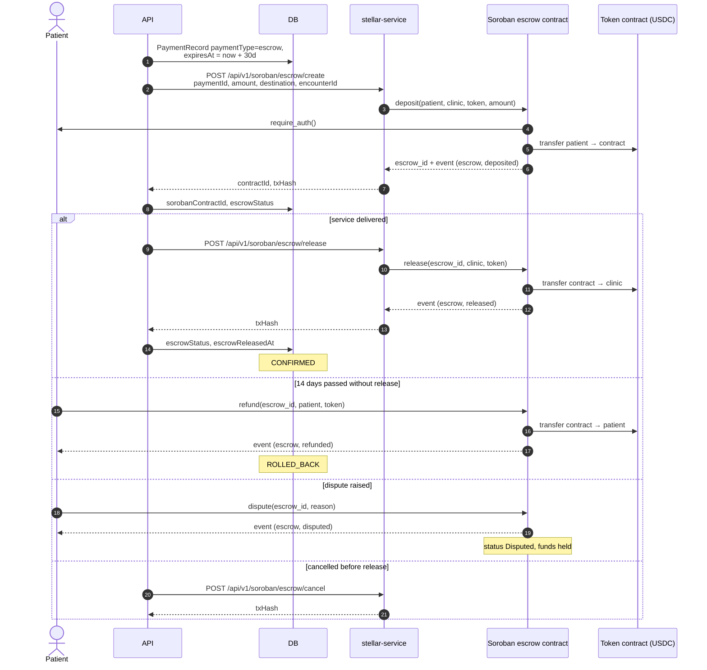
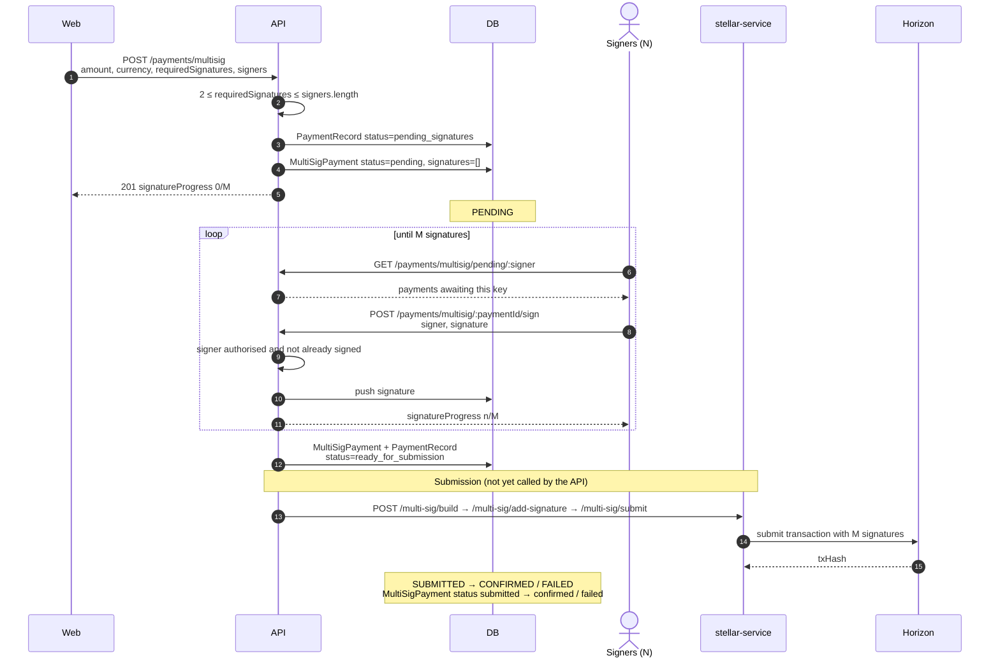
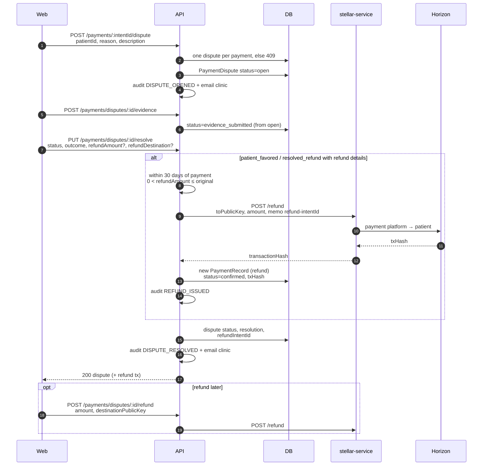
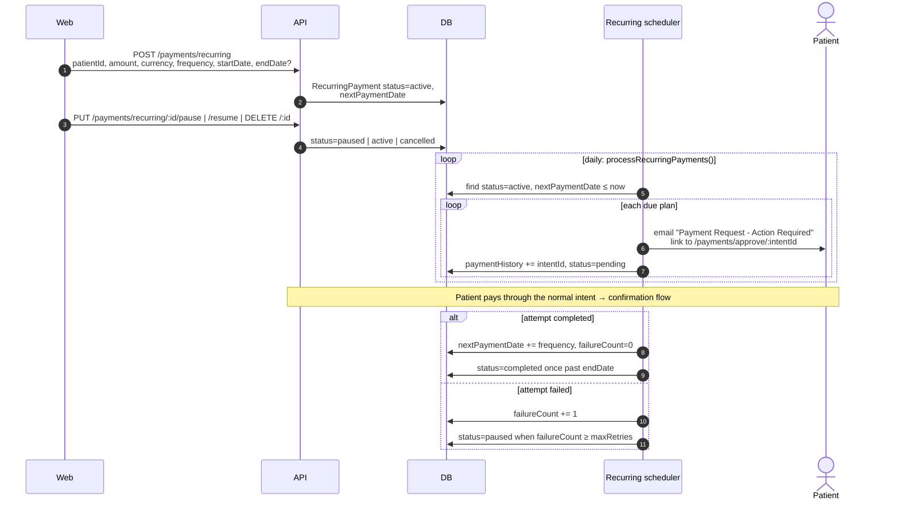
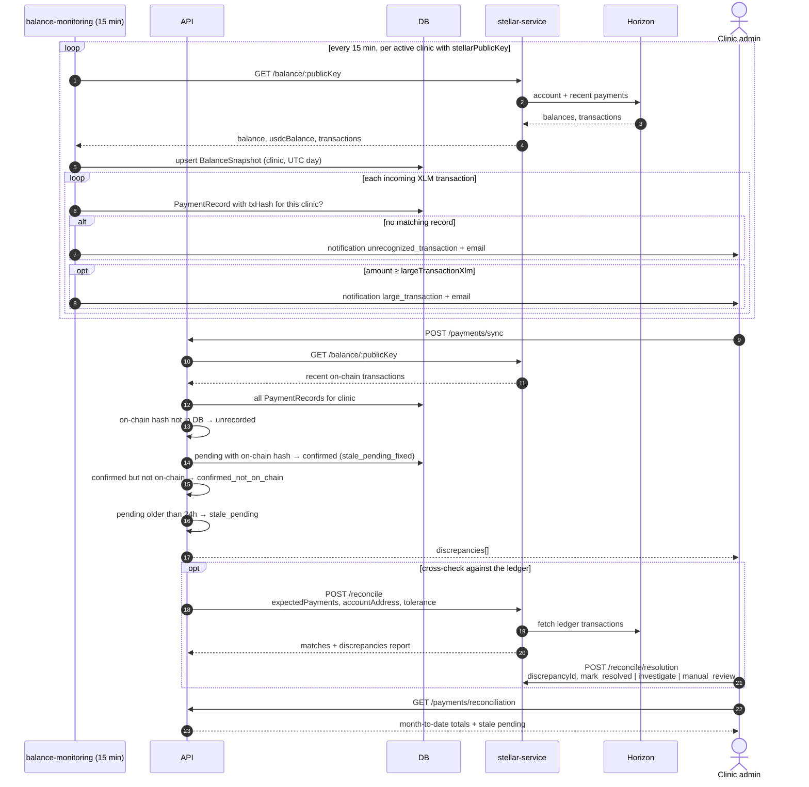

# Payment Lifecycle Diagrams

These diagrams follow a Stellar payment across the web app, the API
(`apps/api`), `stellar-service` (`apps/stellar-service`), Horizon, the background
jobs and outbound webhooks.

**Participants used throughout**

| Name           | What it is                                                                                       |
| -------------- | ------------------------------------------------------------------------------------------------ |
| Web            | Next.js app (`apps/web`) or the patient portal                                                   |
| Wallet         | The patient's Stellar wallet (Freighter, Lobstr, …) that signs and submits transactions        |
| API            | Express API (`apps/api`)                                                                         |
| DB             | MongoDB (`PaymentRecord`, `PreAuth`, `MultiSigPayment`, `PaymentDispute`, `RecurringPayment`, …) |
| Outbox         | Transactional outbox + relay (`modules/outbox`, #1432)                                           |
| SS             | `stellar-service`, the only component holding the platform signing key                          |
| Horizon        | Stellar Horizon API                                                                              |
| Jobs           | BullMQ scheduled jobs; see `docs/BACKGROUND_JOBS.md` in the repository                           |
| Consumer       | Third-party webhook endpoint; see `docs/WEBHOOK_CONSUMER_GUIDE.md` in the repository             |

---

## State model

`apps/stellar-service/src/payment-state-machine.ts` defines the canonical lifecycle:

`CONFIRMED`, `FAILED` and `ROLLED_BACK` are terminal. A rollback always needs a reason.

### Mapping to persisted state

The API stores a coarser `PaymentRecord.status`. The table maps each
state-machine state to what is stored and what causes the transition.

| State machine | `PaymentRecord.status` | Set by                                                                                                                                     |
| ------------- | ---------------------- | ------------------------------------------------------------------------------------------------------------------------------------------ |
| `PENDING`     | `pending`              | `POST /payments/intent`, claimable balance creation                                                                                         |
| `SUBMITTED`   | `pending` (+ `txHash` once known) | Not stored separately: the wallet submits to Horizon, and the API only learns the hash on confirm or from the payment stream       |
| `CONFIRMED`   | `confirmed`            | `confirmPayment()` (via `PATCH /payments/:intentId/confirm` or `POST /webhooks/stellar`), `reconciliation` job, `POST /payments/sync`, claimable claim |
| `FAILED`      | `failed`               | Validation mismatch on confirm, `payment-expiration` job, `reconciliation` job, claimable reclaim                                          |
| `ROLLED_BACK` | no direct equivalent   | A refund creates a **new** `confirmed` `PaymentRecord` for the refund; the original stays `confirmed` and the dispute records the outcome |

Escrow and multisig flows also use the side fields `paymentType`, `escrowStatus`
and `MultiSigPayment.status`, shown in their diagrams.

---

## Payment intent → confirmation

The standard patient payment. The API never holds the patient's key: the wallet
signs and submits, and the API verifies the result on-chain.

Notes:

- Whichever path confirms first wins. The status filter in `confirmPayment()`
  (`status != confirmed`) makes the second path a no-op (`already_confirmed`).
- `stellar-service` retries `POST /webhooks/stellar` 3 times on network errors
  or 5xx, and stops on 4xx.
- The exchange rate comes from the `xlm-rate` job's cache (`1` for USDC, `0` if
  no rate is available).

### Expiry and stale-payment cleanup

---

## Claimable balances

Insurance pre-authorisation holds the patient's estimated cost in a Stellar
claimable balance (`modules/pre-auth`). The clinic claims it after approval;
on denial or expiry the patient gets it back.

| Record                         | Created       | Claimed                                  | Reclaimed / denied              |
| ------------------------------ | ------------- | ---------------------------------------- | ------------------------------- |
| `PreAuth.status`               | `pending` → `approved` | `claimed`                       | `denied`                        |
| `PaymentRecord.status` (claimable records) | `pending` (PENDING) | `confirmed`, `claimed=true` (CONFIRMED) | `failed` (FAILED)           |

> `modules/payments/claimable-balance.controller.ts` (create / claim / reclaim on
> `PaymentRecord`) simulates the Stellar calls and isn't mounted on a route.
> The pre-auth flow above is the one that talks to Stellar.

---

## Escrow (Soroban)

The `contracts/escrow` Soroban contract holds a patient's tokens until the clinic
confirms service delivery. The patient can get a refund after 14 days, and either
party can raise a dispute.

| Contract `EscrowStatus` | State machine              |
| ----------------------- | -------------------------- |
| `Active`                | `SUBMITTED`                |
| `Released`              | `CONFIRMED`                |
| `Refunded`              | `ROLLED_BACK`              |
| `Disputed`              | `SUBMITTED` (funds held)   |
| `Cancelled`             | `FAILED`                   |

The API records the contract side on `PaymentRecord` in `sorobanContractId`,
`escrowStatus` and `escrowReleasedAt` (migration `20260528_add_soroban_escrow`).

> **Implementation status:** the API client is `SorobanEscrowService`
> (`modules/payments/services/soroban-escrow.service.ts`), but `stellar-service`
> doesn't expose the `/api/v1/soroban/escrow/*` routes yet. The diagram shows the
> intended contract interaction.

---

## Multisig approval

High-value payments that need M-of-N signatures before submission.

> **Implementation status:** signature collection is implemented; submission is
> not. `stellar-service` exposes `/multi-sig/build`, `/multi-sig/add-signature` and
> `/multi-sig/submit`, but nothing in the API calls them. Also,
> `pending_signatures` and `ready_for_submission` are written to
> `PaymentRecord.status`, which the schema enum restricts to `pending`,
> `confirmed` and `failed`, so schema validation on create rejects
> `pending_signatures`.
> `calculateExpiryDate('multisig')` gives a 24 h expiry for multisig payments.

---

## Disputes and refunds

| `PaymentDispute.status` | Meaning                                   |
| ----------------------- | ----------------------------------------- |
| `open`                  | Dispute raised                            |
| `evidence_submitted`    | At least one piece of evidence attached   |
| `under_review`          | Clinic reviewing                          |
| `resolved_refund`       | Resolved with a refund                    |
| `resolved_no_action`    | Resolved, no refund                       |
| `closed`                | Closed                                    |

In state-machine terms the original payment stays `CONFIRMED`. The refund is a
separate payment from the platform to the patient that is `CONFIRMED` when
created. `ROLLED_BACK` describes the pair.

---

## Recurring payments

> **Implementation status:** `scheduleRecurringPaymentProcessor()` isn't started
> anywhere and isn't registered with the JobRegistry, so the daily loop above doesn't
> run. Also, the generated `recurring_<id>_<ts>` intent id is never stored as a
> `PaymentRecord`, and there is no `/payments/approve/:intentId` route.
> Plan CRUD (create, pause, resume, cancel, update) works.

---

## Reconciliation of unrecognized transactions

Incoming payments to a clinic account that don't match any `PaymentRecord`.

`UnrecognizedTransaction` (`modules/payments/unrecognized`) is the persistent
record for these transactions: one row per `stellarTxHash`, with `resolved`,
`resolvedAt` and `resolvedBy`.
`detectUnrecognizedTransactions()` upserts rows and
`getUnrecognizedTransactions(clinicId)` lists the open ones. The balance monitor
alerts but doesn't write these rows yet.

---

## See also

- [Stellar Integration Guide](./overview.md)
- Repository docs: `docs/BACKGROUND_JOBS.md`, `docs/WEBHOOK_CONSUMER_GUIDE.md`, `docs/REALTIME_EVENTS.md`
