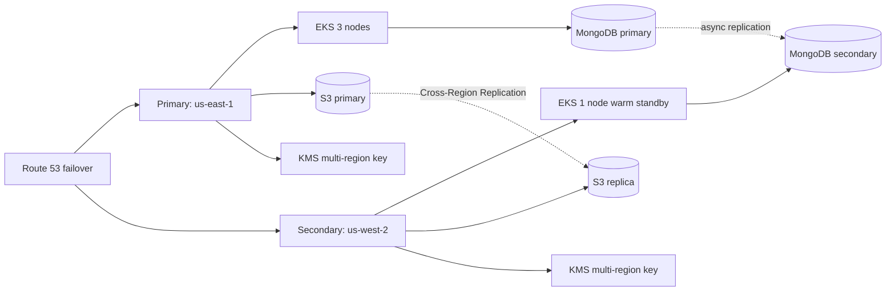

# Deployment Guide

This guide covers deploying Health Watchers to production environments using Docker, Docker Compose, and Kubernetes.

## Table of Contents

- [Prerequisites](#prerequisites)
- [Docker Deployment](#docker-deployment)
- [Docker Compose Deployment](#docker-compose-deployment)
- [Kubernetes Deployment](#kubernetes-deployment)
- [Container Image Signing](#container-image-signing)
- [Terraform Infrastructure Bootstrap](#terraform-infrastructure-bootstrap)
- [Cost Management](#cost-management)
- [Multi-Region Deployment](#multi-region-deployment)
- [Blue-Green Deployment](BLUE_GREEN_DEPLOYMENT.md)
- [Health Checks](#health-checks)
- [Troubleshooting](#troubleshooting)
- [Runbooks](#runbooks)
- [Performance Tuning](#performance-tuning)

## Prerequisites

### Required Tools

| Tool | Minimum Version | Install |
|------|----------------|---------|
| Docker | 24.x | [docs.docker.com](https://docs.docker.com/get-docker/) |
| Docker Compose | 2.x | Bundled with Docker Desktop |
| Node.js | 18.0.0 | [nodejs.org](https://nodejs.org/) |
| npm | 10.9.2 | Bundled with Node.js |
| Git | 2.x | [git-scm.com](https://git-scm.com/) |

### For Kubernetes Deployments

| Tool | Minimum Version | Purpose |
|------|----------------|---------|
| kubectl | 1.28+ | Cluster management |
| Helm | 3.x | Chart-based deployments |
| AWS CLI | 2.x | ECR image push, Secrets Manager |

### Infrastructure Requirements

| Component | Minimum (staging) | Recommended (prod) |
|-----------|------------------|-------------------|
| API server | 512 MB RAM, 0.5 vCPU | 1 GB RAM, 1 vCPU |
| Web server | 512 MB RAM, 0.5 vCPU | 1 GB RAM, 1 vCPU |
| Stellar service | 256 MB RAM, 0.25 vCPU | 512 MB RAM, 0.5 vCPU |
| MongoDB | 1 GB RAM, 1 vCPU | 4 GB RAM, 2 vCPU (replica set) |

### Required Environment Variables

Copy `.env.example` and fill in all required values before deploying:

```bash
cp .env.example .env
```

Key variables to configure before first deploy:

```bash
# Database
MONGO_URI=mongodb://...

# JWT Secrets — generate with: openssl rand -hex 64
JWT_ACCESS_TOKEN_SECRET=<64-char hex>
JWT_REFRESH_TOKEN_SECRET=<64-char hex>

# CSRF — generate with: openssl rand -hex 32
CSRF_SECRET=<32-char hex>

# Stellar
STELLAR_NETWORK=testnet     # or: public (mainnet)
STELLAR_KEYPAIR=<encrypted keypair JSON>

# Frontend
NEXT_PUBLIC_API_URL=https://api.healthwatchers.com

# Optional but recommended
SENTRY_DSN=<your-sentry-dsn>
SENDGRID_API_KEY=<key>
AWS_REGION=us-east-1
```

> Generate strong secrets: `openssl rand -hex 64`

### Recommended

- Helm (for Kubernetes package management)
- AWS CLI
- Git

## Docker Deployment

### Building Docker Images

Build all application images:

```bash
# Build API image
docker build -t health-watchers-api:latest apps/api

# Build Web image
docker build -t health-watchers-web:latest apps/web

# Build Stellar Service image
docker build -t health-watchers-stellar:latest apps/stellar-service

# Or use the build script
./scripts/docker-build.sh
```

### Running Individual Containers

**API Server:**
```bash
docker run -d \
  --name health-watchers-api \
  -p 3001:3001 \
  -e MONGO_URI=mongodb://mongo:27017/health_watchers \
  -e JWT_ACCESS_TOKEN_SECRET=your_secret \
  -e NODE_ENV=production \
  health-watchers-api:latest
```

**Web Application:**
```bash
docker run -d \
  --name health-watchers-web \
  -p 3000:3000 \
  -e NEXT_PUBLIC_API_URL=http://localhost:3001 \
  health-watchers-web:latest
```

**Stellar Service:**
```bash
docker run -d \
  --name health-watchers-stellar \
  -p 3002:3002 \
  -e STELLAR_NETWORK=testnet \
  -e STELLAR_KEYPAIR=your_keypair \
  health-watchers-stellar:latest
```

## Docker Compose Deployment

Docker Compose configurations have been unified with profiles for easier management.

### Available Profiles

| Profile | Services | Use Case |
|---------|----------|----------|
| `core` | API, web, stellar-service, MongoDB, Redis, Jaeger | Development, basic setup |
| `dev-tools` | mongo-express | Database management UI |
| `monitoring` | Prometheus, Grafana, AlertManager, node-exporter | Metrics and alerts |
| `elk` | Elasticsearch, Logstash, Kibana | Centralized logging |
| `replica` | MongoDB replica set (3 nodes + arbiter) | HA testing/production |

### Quick Start (Development)

Start core services:

```bash
# Start API, web, stellar-service, MongoDB, Redis, Jaeger
docker compose --profile core up -d

# View logs
docker compose logs -f

# Stop services
docker compose --profile core down
```

### Development with Database UI

```bash
# Start core + mongo-express
docker compose --profile core --profile dev-tools up -d

# Access mongo-express at http://localhost:8081
```

### With Monitoring Stack

```bash
# Start core + Prometheus, Grafana, AlertManager
docker compose --profile core --profile monitoring up -d

# Access:
# - Grafana: http://localhost:3003 (admin/admin)
# - Prometheus: http://localhost:9090
# - AlertManager: http://localhost:9093
```

### With ELK Logging

```bash
# Start core + ELK stack
docker compose --profile core --profile elk up -d

# Access Kibana at http://localhost:5601
# Username: elastic
# Password: check ELASTIC_PASSWORD in .env (default: changeme)
```

### Production Deployment

Use the production override file:

```bash
# Deploy with production settings
docker compose -f docker-compose.yml -f docker-compose.prod.yml --profile core up -d

# Ensure all production environment variables are set in .env
```

Production differences:
- Uses production Dockerfiles (`Dockerfile.prod`)
- No hot-reload volume mounts
- Stricter restart policies (`restart: always`)
- Redis with authentication
- Healthchecks enabled
- Resource limits enforced

### Production Deployment

```bash
# Copy environment file
cp .env.example .env.production
# Edit .env.production with production values

# Start with production compose file
docker-compose -f docker-compose.prod.yml up -d

# Check status
docker-compose -f docker-compose.prod.yml ps

# View logs
docker-compose -f docker-compose.prod.yml logs -f api

# Stop services gracefully
docker-compose -f docker-compose.prod.yml down
```

### Production Environment Variables

Create `.env.production`:

```bash
# Node Environment
NODE_ENV=production

# Database
MONGO_URI=mongodb://mongo-0.mongo-service:27017,mongo-1.mongo-service:27017,mongo-2.mongo-service:27017/health_watchers?replicaSet=rs0
MONGO_POOL_SIZE=50
MONGO_CONNECT_TIMEOUT=10000

# JWT
JWT_ACCESS_TOKEN_SECRET=<generate-strong-secret>
JWT_REFRESH_TOKEN_SECRET=<generate-strong-secret>
JWT_ACCESS_TOKEN_EXPIRY=3600
JWT_REFRESH_TOKEN_EXPIRY=604800

# API
API_PORT=3001
API_HOST=0.0.0.0
NEXT_PUBLIC_API_URL=https://api.healthwatchers.com

# Frontend
NEXT_PUBLIC_BASE_URL=https://healthwatchers.com

# Stellar
STELLAR_NETWORK=public
STELLAR_KEYPAIR=<encrypted-keypair>

# Security
CSRF_SECRET=<generate-strong-secret>
SESSION_SECRET=<generate-strong-secret>

# External Services
SENDGRID_API_KEY=<key>
AWS_REGION=us-east-1
AWS_ACCESS_KEY_ID=<key>
AWS_SECRET_ACCESS_KEY=<secret>

# Monitoring
SENTRY_DSN=<your-sentry-dsn>
LOG_LEVEL=info
```

## Kubernetes Deployment

### Prerequisites

- Kubernetes cluster (EKS, AKS, GKE, or self-hosted)
- kubectl configured
- Helm installed (optional but recommended)

### Using Helm

The easiest way to deploy to Kubernetes:

```bash
# Add Helm repository (if using a chart repo)
helm repo add health-watchers https://charts.healthwatchers.com
helm repo update

# Install release
helm install hw-production health-watchers/health-watchers \
  --namespace production \
  --create-namespace \
  -f helm/values-production.yaml

# Upgrade release
helm upgrade hw-production health-watchers/health-watchers \
  -f helm/values-production.yaml

# Uninstall
helm uninstall hw-production -n production
```

### Using kubectl (Manual)

```bash
# Create namespace
kubectl create namespace production

# Create secrets
kubectl create secret generic hw-secrets \
  -n production \
  --from-literal=MONGO_URI=$MONGO_URI \
  --from-literal=JWT_ACCESS_TOKEN_SECRET=$JWT_SECRET

# Deploy MongoDB (optional)
kubectl apply -f k8s/mongodb-replica-set-statefulset.yaml -n production

# Deploy API
kubectl apply -f k8s/api/deployment.yaml -n production
kubectl apply -f k8s/api/service.yaml -n production

# Deploy Web
kubectl apply -f k8s/web/deployment.yaml -n production
kubectl apply -f k8s/web/service.yaml -n production

# Deploy Stellar Service
kubectl apply -f k8s/stellar-service/deployment.yaml -n production
kubectl apply -f k8s/stellar-service/service.yaml -n production

# Setup Ingress
kubectl apply -f k8s/ingress.yaml -n production
```

### Verify Deployment

```bash
# Check pods
kubectl get pods -n production

# Check services
kubectl get svc -n production

# Check logs
kubectl logs -n production deployment/api -f

# Port forward for testing
kubectl port-forward -n production svc/api 3001:3001
```

### Scaling

```bash
# Scale API deployment
kubectl scale deployment api -n production --replicas=3

# Autoscaling
kubectl apply -f k8s/api/hpa.yaml -n production
```

## Container Image Signing

All container images published by CI are signed with [Sigstore cosign](https://docs.sigstore.dev/cosign/overview/)
using **keyless** signing backed by GitHub Actions OIDC. In a HIPAA environment this
provides verifiable image provenance: the Kyverno admission controller rejects any
image that does not carry a valid signature from our build workflow.

### How Images Are Signed in CI

The Docker build workflow (`.github/workflows/docker-build.yml`) signs every image
it pushes to the registry:

1. The workflow authenticates to the registry and builds/pushes the image.
2. It installs `sigstore/cosign` via `sigstore/cosign-installer`.
3. It signs the immutable image digest (not the mutable tag) with:

   ```bash
   cosign sign --yes \
     ghcr.io/health-watchers/api@sha256:<digest>
   ```

4. The signature, certificate, and transparency-log entry are stored in the
   registry alongside the image (as an OCI artifact). No long-lived private key
   exists — the ephemeral key is bound to the GitHub OIDC identity of the workflow
   run (`https://token.actions.githubusercontent.com`).

Because signing is keyless, the identity that matters during verification is the
**workflow identity** (repository + workflow path + ref), not a static key.

### Verifying Signatures Manually

Install cosign locally ([releases](https://github.com/sigstore/cosign/releases)),
then verify an image against the expected workflow identity:

```bash
cosign verify \
  --certificate-identity-regexp '^https://github.com/health-watchers/health-watchers/.github/workflows/docker-build.yml@refs/heads/main$' \
  --certificate-oidc-issuer https://token.actions.githubusercontent.com \
  ghcr.io/health-watchers/api@sha256:<digest>
```

A successful verification prints the signature payload and exits `0`. Any other
result (missing signature, wrong identity, wrong issuer) exits non-zero.

You can also verify with the committed public key in `k8s/cosign.pub`:

```bash
cosign verify --key k8s/cosign.pub ghcr.io/health-watchers/api@sha256:<digest>
```

> `k8s/cosign.pub` holds the public key used for verification. Treat it as
> read-only configuration; rotate it only through a reviewed PR and update the
> Kyverno policy in the same change.

### Admission Control (Kyverno)

The cluster enforces signatures with a Kyverno `ClusterPolicy`
(`k8s/kyverno-verify-image-signature.yaml`). It matches all pods in the
`production` and `staging` namespaces and verifies each image against the
attestors configured in the policy (keyless identity **and** `k8s/cosign.pub`).
Unsigned or unverifiable images are rejected at admission time with an error such
as:

```
failed to verify image ghcr.io/health-watchers/api:latest:
  .attestors[0].entries[0].keys: no matching signatures
```

Apply the policy after installing Kyverno:

```bash
# Install Kyverno (if not already present)
helm repo add kyverno https://kyverno.github.io/kyverno
helm repo update
helm install kyverno kyverno/kyverno -n kyverno --create-namespace

# Apply the image verification policy
kubectl apply -f k8s/kyverno-verify-image-signature.yaml

# Confirm the policy is ready
kubectl get clusterpolicy verify-image-signatures
```

The policy runs in `Enforce` mode in production. In staging it may run in `Audit`
mode first so violations are reported (via `kubectl get policyreport -A`) without
blocking deploys.

### Troubleshooting Image Signing

**`cosign verify` fails with `no matching signatures`:**
- Confirm you are verifying the **digest**, not a tag that was re-pushed.
- Confirm the image was built by the CI workflow (locally built images are unsigned).
- Check the identity/issuer flags match the workflow path and branch exactly.

**`cosign verify` fails with `certificate identity mismatch`:**
- The image was signed from a different branch or fork. Re-run the workflow on
  `main` and redeploy the resulting digest.

**Pod rejected with `failed to verify image ... no matching signatures`:**
- The image is unsigned or was pushed outside CI. Rebuild via the workflow.
- If the policy itself is misconfigured, inspect it with
  `kubectl get clusterpolicy verify-image-signatures -o yaml` and check the
  Kyverno logs: `kubectl logs -n kyverno -l app.kubernetes.io/name=kyverno`.

**Kyverno cannot reach the registry / transparency log:**
- Ensure cluster egress allows the registry and `*.sigstore.dev` /
  `rekor.sigstore.dev`. Air-gapped clusters must mirror the signature artifacts
  and use a local Rekor instance.

**Signature verification passes locally but fails in-cluster:**
- Verify the policy references the same `k8s/cosign.pub` content that is deployed
  (`kubectl get configmap -n kyverno` / the policy's inline key). A stale key after
  rotation is the most common cause.

## Terraform Infrastructure Bootstrap

All AWS infrastructure (VPC, EKS, S3, SES, IAM) is managed as code in the
[`terraform/`](../terraform/) directory. Terraform state is stored remotely in S3
with DynamoDB locking — never commit state files or plan output.

### Terraform Directory Layout

```
terraform/
├── modules/
│   ├── vpc/            # VPC, subnets, NAT gateways, route tables
│   ├── eks/            # EKS cluster, node groups, OIDC provider
│   ├── s3/             # Application, backup, and log buckets
│   ├── ses/            # SES domain identity, DKIM, sending limits
│   └── iam/            # IRSA roles, CI deploy roles, service policies
├── environments/
│   ├── staging/        # Staging backend config + tfvars
│   └── production/     # Production backend config + tfvars
└── bootstrap/          # One-time state bucket + lock table creation
```

### Step 1: Bootstrap Remote State (one-time, per AWS account)

The state bucket and lock table must exist before any environment can be
initialized. Run this once per AWS account:

```bash
cd terraform/bootstrap

# Review what will be created (S3 state bucket + DynamoDB lock table)
terraform init
terraform plan -out=bootstrap.tfplan

# Apply
terraform apply bootstrap.tfplan

# Note the outputs — you will need them for the backend configs
terraform output state_bucket_name
terraform output lock_table_name
```

This creates:

| Resource | Purpose |
|----------|---------|
| `health-watchers-terraform-state` (S3) | Remote state storage, versioned, encrypted, public access blocked |
| `health-watchers-terraform-locks` (DynamoDB) | State locking (`LockID` partition key) |

> The bootstrap module uses local state. Keep `terraform/bootstrap/terraform.tfstate`
> in a secure location (e.g. a password manager or secrets vault) — it is gitignored.

### Step 2: Initialize an Environment

Each environment has its own backend config and variable file:

```bash
cd terraform/environments/staging

# Initialize with the staging backend (S3 + DynamoDB)
terraform init -backend-config=backend.hcl

# Validate and plan
terraform validate
terraform plan -var-file=staging.tfvars -out=staging.tfplan

# Apply
terraform apply staging.tfplan
```

For production, use the same flow from `terraform/environments/production`:

```bash
cd terraform/environments/production
terraform init -backend-config=backend.hcl
terraform plan -var-file=production.tfvars -out=production.tfplan
terraform apply production.tfplan
```

Example `backend.hcl` (one per environment, distinct state key):

```hcl
bucket         = "health-watchers-terraform-state"
key            = "environments/staging/terraform.tfstate"
region         = "us-east-1"
dynamodb_table = "health-watchers-terraform-locks"
encrypt        = true
```

> Use a different `key` for each environment (e.g.
> `environments/production/terraform.tfstate`). Never share a state key between
> environments.

### Step 3: Wire Terraform Outputs into Kubernetes

After applying, feed the outputs into the Helm values / k8s manifests:

```bash
# EKS cluster name and endpoint
terraform output eks_cluster_name
terraform output eks_cluster_endpoint

# Configure kubectl for the new cluster
aws eks update-kubeconfig \
  --name "$(terraform output -raw eks_cluster_name)" \
  --region us-east-1

# S3 bucket names for backups and uploads
terraform output s3_backup_bucket
terraform output s3_uploads_bucket

# IAM role ARNs for IRSA (service accounts)
terraform output iam_api_role_arn
```

Set the corresponding values in `helm/values-production.yaml` (or the staging
equivalent) before running `helm upgrade`.

### CI: `terraform plan` on Pull Requests

The GitHub Actions workflow `.github/workflows/terraform-plan.yml` runs
automatically on any pull request that touches `terraform/`:

1. `terraform fmt -check -recursive` — formatting gate
2. `terraform init -backend-config=...` for the affected environment
3. `terraform validate`
4. `terraform plan` — the plan is posted as a PR comment for review

The workflow authenticates to AWS via OIDC (no long-lived keys) using the CI
deploy role created by the `iam` module. `terraform apply` is **not** run in CI;
applies are performed manually (or from a protected environment workflow) after
the plan is reviewed and approved.

To run the same checks locally before pushing:

```bash
cd terraform/environments/staging
terraform fmt -check -recursive ../../
terraform init -backend-config=backend.hcl
terraform validate
terraform plan -var-file=staging.tfvars
```

### Terraform Troubleshooting

**State lock error (`Error acquiring the state lock`):**
```bash
# Inspect the lock entry
aws dynamodb get-item \
  --table-name health-watchers-terraform-locks \
  --key '{"LockID": {"S": "health-watchers-terraform-state/environments/staging/terraform.tfstate-md5"}}'

# Force-unlock only if you are certain no other apply is running
terraform force-unlock <LOCK_ID>
```

**Backend initialization fails:** verify the S3 bucket and DynamoDB table exist
(run the bootstrap step) and that your AWS credentials have access to both.

**Drift detected:** run `terraform plan` to inspect differences; do not edit
resources manually in the AWS console.

## Cost Management

The production stack runs on EKS, S3, SES, and AWS Secrets Manager. This section
covers how to track spend, alert on budget overruns, estimate cost changes before
merging infrastructure changes, and periodically review for optimization.

### AWS Cost and Usage Report (CUR)

The Cost and Usage Report is the most granular billing data source AWS provides
(hourly line items, resource IDs, and cost allocation tags). It is the basis for
both the budget alarm and the cost reports in `scripts/cost/`.

#### Step 1: Create the CUR bucket and report

```bash
# 1. Create a dedicated, private bucket for CUR data
aws s3api create-bucket \
  --bucket health-watchers-cur \
  --region us-east-1

aws s3api put-public-access-block \
  --bucket health-watchers-cur \
  --public-access-block-configuration \
    BlockPublicAcls=true,IgnorePublicAcls=true,BlockPublicPolicy=true,RestrictPublicBuckets=true

# 2. Apply the bucket policy that lets the Billing service write to it
#    (replace ACCOUNT_ID with your 12-digit account number)
cat > /tmp/cur-bucket-policy.json <<'EOF'
{
  "Version": "2012-10-17",
  "Statement": [
    {
      "Sid": "AllowBillingServiceWrite",
      "Effect": "Allow",
      "Principal": { "Service": "billingreports.amazonaws.com" },
      "Action": ["s3:GetBucketAcl", "s3:GetBucketPolicy"],
      "Resource": "arn:aws:s3:::health-watchers-cur"
    },
    {
      "Sid": "AllowBillingServicePutObject",
      "Effect": "Allow",
      "Principal": { "Service": "billingreports.amazonaws.com" },
      "Action": "s3:PutObject",
      "Resource": "arn:aws:s3:::health-watchers-cur/*"
    }
  ]
}
EOF

aws s3api put-bucket-policy \
  --bucket health-watchers-cur \
  --policy file:///tmp/cur-bucket-policy.json

# 3. Create the report (Parquet, hourly, with resource IDs)
aws cur put-report-definition \
  --report-definition '{
    "ReportName": "health-watchers-cur",
    "TimeUnit": "HOURLY",
    "Format": "Parquet",
    "Compression": "Parquet",
    "AdditionalSchemaElements": ["RESOURCES"],
    "S3Bucket": "health-watchers-cur",
    "S3Prefix": "reports",
    "S3Region": "us-east-1",
    "RefreshClosedReports": true,
    "ReportVersioning": "OVERWRITE_REPORT"
  }'
```

> The first report can take up to 24 hours to appear. Subsequent reports are
> delivered several times per day.

#### Step 2: Query the report with Athena

```bash
# Create a database for billing data
aws athena start-query-execution \
  --query-string "CREATE DATABASE IF NOT EXISTS health_watchers_billing" \
  --result-configuration OutputLocation=s3://health-watchers-cur/athena-results/

# Create the CUR table (adjust columns to match your report schema;
# the full schema is in the CUR data dictionary)
aws athena start-query-execution \
  --query-string "
    CREATE EXTERNAL TABLE IF NOT EXISTS health_watchers_billing.cur (
      line_item_usage_account_id string,
      line_item_usage_start_date timestamp,
      line_item_usage_end_date timestamp,
      line_item_product_code string,
      line_item_resource_id string,
      line_item_usage_type string,
      line_item_unblended_cost double,
      product_region string,
      resource_tags_user_environment string
    )
    PARTITIONED BY (year string, month string)
    STORED AS PARQUET
    LOCATION 's3://health-watchers-cur/reports/health-watchers-cur/'
  " \
  --result-configuration OutputLocation=s3://health-watchers-cur/athena-results/
```

Example query — monthly spend by service:

```sql
SELECT line_item_product_code AS service,
       ROUND(SUM(line_item_unblended_cost), 2) AS cost_usd
FROM health_watchers_billing.cur
WHERE year = '2026' AND month = '07'
GROUP BY line_item_product_code
ORDER BY cost_usd DESC;
```

#### Step 3: IAM permissions

Create a read-only role for cost tooling (used by `scripts/cost/*` and CI):

```json
{
  "Version": "2012-10-17",
  "Statement": [
    {
      "Effect": "Allow",
      "Action": [
        "ce:GetCostAndUsage",
        "ce:GetCostForecast",
        "ce:GetDimensionValues",
        "ce:GetReservationUtilization",
        "ce:GetSavingsPlansUtilization",
        "cloudwatch:GetMetricStatistics",
        "cloudwatch:PutMetricAlarm",
        "cloudwatch:DescribeAlarms",
        "athena:StartQueryExecution",
        "athena:GetQueryExecution",
        "athena:GetQueryResults",
        "glue:GetTable",
        "glue:GetDatabase",
        "s3:GetObject",
        "s3:ListBucket"
      ],
      "Resource": "*"
    }
  ]
}
```

Attach this policy to the CI deploy role and to the on-call engineer's role.
Never grant `ce:*` or `billing:*` write access to application workloads.

### CloudWatch Billing Alarm

Set the expected monthly budget in a variable and create an alarm that fires at
80% of budget (warning) and 100% (critical). The alarm publishes to the SNS
topic used by Alertmanager.

```bash
# Expected monthly budget in USD
MONTHLY_BUDGET_USD=1500
ALARM_THRESHOLD=$(awk "BEGIN { printf \"%d\", $MONTHLY_BUDGET_USD * 0.8 }")

# 1. Create the SNS topic (skip if you already have one)
aws sns create-topic --name health-watchers-billing-alerts
BILLING_TOPIC_ARN=$(aws sns list-topics \
  --query "Topics[?ends_with(TopicArn, 'health-watchers-billing-alerts')].TopicArn" \
  --output text)

# 2. Subscribe the on-call email
aws sns subscribe \
  --topic-arn "$BILLING_TOPIC_ARN" \
  --protocol email \
  --notification-endpoint devops@healthwatchers.com

# 3. Create the alarm on EstimatedCharges (us-east-1 only)
aws cloudwatch put-metric-alarm \
  --alarm-name "health-watchers-monthly-budget-80pct" \
  --alarm-description "Estimated AWS charges exceeded 80% of the monthly budget" \
  --namespace AWS/Billing \
  --metric-name EstimatedCharges \
  --dimensions Name=Currency,Value=USD \
  --statistic Maximum \
  --period 21600 \
  --evaluation-periods 1 \
  --threshold "$ALARM_THRESHOLD" \
  --comparison-operator GreaterThanThreshold \
  --treat-missing-data notBreaching \
  --alarm-actions "$BILLING_TOPIC_ARN" \
  --region us-east-1
```

Equivalent Terraform (add to `terraform/environments/production/`):

```hcl
variable "monthly_budget_usd" {
  type    = number
  default = 1500
}

resource "aws_sns_topic" "billing_alerts" {
  name = "health-watchers-billing-alerts"
}

resource "aws_cloudwatch_metric_alarm" "monthly_budget" {
  alarm_name          = "health-watchers-monthly-budget-80pct"
  alarm_description   = "Estimated AWS charges exceeded 80% of the monthly budget"
  namespace           = "AWS/Billing"
  metric_name         = "EstimatedCharges"
  dimensions          = { Currency = "USD" }
  statistic           = "Maximum"
  period              = 21600
  evaluation_periods  = 1
  threshold           = var.monthly_budget_usd * 0.8
  comparison_operator = "GreaterThanThreshold"
  treat_missing_data  = "notBreaching"
  alarm_actions       = [aws_sns_topic.billing_alerts.arn]
  region              = "us-east-1"
}
```

> `AWS/Billing` metrics are only published in `us-east-1`. The alarm must be
> created there regardless of where the workload runs.

### Cost Estimation with infracost

[infracost](https://www.infracost.io/) produces a cost diff for Terraform
changes, so reviewers can see the monthly cost impact of a PR before merging.

```bash
# Install (macOS/Linux)
brew install infracost          # macOS
# or
curl -fsSL https://raw.githubusercontent.com/infracost/infracost/master/scripts/install.sh | sh

# Authenticate (free API key from https://dashboard.infracost.io)
infracost auth login

# Generate a baseline for the current main branch
cd terraform/environments/production
infracost breakdown --path . --format json --out-file /tmp/infracost-base.json

# After making changes, produce a diff against the baseline
infracost diff --path . --compare-to /tmp/infracost-base.json
```

Add a CI step to `.github/workflows/terraform-plan.yml` after the plan step:

```yaml
      - name: Setup Infracost
        uses: infracost/actions/setup@v3
        with:
          api-key: ${{ secrets.INFRACOST_API_KEY }}

      - name: Generate Infracost diff
        run: |
          infracost diff \
            --path terraform/environments/production \
            --format json \
            --out-file /tmp/infracost.json

      - name: Post Infracost comment
        run: |
          infracost comment github \
            --path /tmp/infracost.json \
            --repo "$GITHUB_REPOSITORY" \
            --pull-request "${{ github.event.pull_request.number }}" \
            --github-token "${{ secrets.GITHUB_TOKEN }}" \
            --behavior update
```

Store `INFRACOST_API_KEY` as a repository secret. The comment is updated on
each push, so reviewers always see the current estimate.

### Approximate Monthly Costs

The figures below are order-of-magnitude estimates for `us-east-1` at
on-demand pricing (as of 2026). Actual costs vary with usage, data transfer,
and Savings Plans. Re-run `scripts/cost/cost-report.sh` for live numbers.

#### EKS — 3-node cluster

| Item | Spec | Est. monthly |
|------|------|--------------|
| EKS control plane | 1 cluster | ~$73 |
| Worker nodes | 3 × `m6i.xlarge` (4 vCPU, 16 GB) | ~$420 |
| EBS volumes | 3 × 100 GB gp3 | ~$24 |
| NAT gateways | 2 AZs | ~$65 |
| Load balancer | 1 ALB | ~$20 |
| **Total** | | **~$600** |

> Using Spot or Graviton (`m7g.xlarge`) nodes can cut node cost by 30–60%.
> A managed node group with a mixed-instance policy is recommended for prod.

#### S3 storage

| Item | Volume | Est. monthly |
|------|--------|--------------|
| Standard storage | 500 GB | ~$12 |
| Standard-IA (backups > 30 days) | 2 TB | ~$25 |
| Glacier Instant Retrieval | 5 TB | ~$20 |
| PUT/GET requests | ~10M | ~$5 |
| **Total** | | **~$62** |

> Enable lifecycle rules (already in the `s3` module) to transition backups to
> IA after 30 days and Glacier after 90 days.

#### SES email volume

| Item | Volume | Est. monthly |
|------|--------|--------------|
| Outbound email | 100,000 messages | ~$10 |
| Attachments / data transfer | 5 GB | ~$1 |
| Dedicated IP (optional) | 1 IP | ~$25 |
| **Total** | | **~$11–36** |

> SES charges $0.10 per 1,000 emails. The first 62,000 emails/month sent from
> an EC2-hosted app are free; from EKS the standard rate applies.

#### AWS Secrets Manager

| Item | Volume | Est. monthly |
|------|--------|--------------|
| Secrets stored | 20 secrets | ~$8 |
| API calls | 1M | ~$5 |
| **Total** | | **~$13** |

> Secrets Manager charges $0.40 per secret/month and $0.05 per 10,000 API
> calls. Cache secrets in the app (already done via the config loader) to keep
> call volume low.

#### Summary

| Service | Est. monthly |
|---------|--------------|
| EKS (3 nodes) | ~$600 |
| S3 | ~$62 |
| SES | ~$11–36 |
| Secrets Manager | ~$13 |
| **Total** | **~$686–711** |

Set `MONTHLY_BUDGET_USD` to roughly 1.3× this figure to leave headroom for
data transfer, CloudWatch, and one-off spikes.

### Cost Optimization Review Checklist

Run this review monthly (and before any major release). The scripts in
`scripts/cost/` automate most of the data gathering.

| Script | Purpose |
|--------|---------|
| `scripts/cost/cost-report.sh` | Pulls CUR/CE data and prints spend by service and tag |
| `scripts/cost/analyze-utilization.sh` | Reports CPU/memory utilization for EKS nodes and pods |
| `scripts/cost/rightsizing-recommendations.sh` | Suggests instance/pod size changes from utilization data |
| `scripts/cost/cleanup-unused-resources.sh` | Finds idle load balancers, unattached EBS, old snapshots, unused EIPs |

**Monthly review checklist:**

- [ ] Run `./scripts/cost/cost-report.sh` and compare month-over-month spend by service.
- [ ] Run `./scripts/cost/analyze-utilization.sh`; flag nodes with < 30% average CPU.
- [ ] Run `./scripts/cost/rightsizing-recommendations.sh`; file tickets for over-provisioned nodes/pods.
- [ ] Run `./scripts/cost/cleanup-unused-resources.sh`; delete confirmed-unused resources.
- [ ] Review S3 lifecycle rules — confirm backups are transitioning to IA/Glacier.
- [ ] Review Savings Plans / Reserved Instance coverage for steady-state EKS nodes.
- [ ] Confirm the CloudWatch billing alarm threshold still matches the current budget.
- [ ] Check NAT gateway data processing charges (often the largest hidden cost).
- [ ] Review Secrets Manager API call volume; confirm caching is effective.
- [ ] Verify no untagged resources exist (all resources must carry `Environment` and `Service` tags).
- [ ] Update the budget in `terraform/environments/production/production.tfvars` if the baseline changed.

## Multi-Region Deployment

For HIPAA compliance and availability, production may need to run across two
AWS regions. This section documents the data residency constraints, the target
architecture, the database strategy, and the failover procedure.

### HIPAA Data Residency Requirements

- **PHI must remain in approved regions.** The BAA with AWS covers all US
  regions, but patient data must not leave the United States. Use `us-east-1`
  (primary) and `us-west-2` (secondary) — both are HIPAA-eligible and within
  the US.
- **No PHI in non-US regions.** Do not replicate S3 buckets, MongoDB data, or
  backups to `eu-*`, `ap-*`, or any region outside the US without a documented
  legal review and updated BAA.
- **Encryption keys are regional.** KMS keys cannot be used cross-region
  directly; use multi-region KMS keys (MRKs) so the secondary region can
  decrypt replicated data.
- **Audit logs must be retained in both regions** for 6 years (HIPAA §164.316).
  S3 Object Lock in compliance mode is recommended for the audit bucket.
- **Data residency must be documented** in the risk assessment and reviewed
  annually by the compliance officer.

**Region selection constraints:**

| Constraint | Requirement |
|------------|-------------|
| Jurisdiction | US only (`us-east-1`, `us-west-2`) |
| HIPAA eligibility | Region must be HIPAA-eligible (all US regions are) |
| Service availability | EKS, S3, SES, Secrets Manager, KMS MRK must all be available |
| Latency | Cross-region replication RTT < 100 ms (us-east-1 ↔ us-west-2 ≈ 60 ms) |
| Cost | Secondary region runs warm-standby (scaled down) to control spend |

### Architecture

```
                    ┌─────────────────────────────────────────────┐
                    │              Route 53 (failover)            │
                    │   health-check on primary ALB /health       │
                    └───────────────┬──────────────┬──────────────┘
                                    │              │
                    ┌───────────────▼───┐      ┌───▼───────────────┐
                    │  PRIMARY          │      │  SECONDARY        │
                    │  us-east-1        │      │  us-west-2        │
                    │                   │      │                   │
                    │  ┌─────────────┐  │      │  ┌─────────────┐  │
                    │  │ EKS (3 node)│  │      │  │ EKS (1 node)│  │
                    │  │ API/Web/    │  │      │  │ API/Web/    │  │
                    │  │ Stellar     │  │      │  │ Stellar     │  │
                    │  └──────┬──────┘  │      │  └──────┬──────┘  │
                    │         │         │      │         │         │
                    │  ┌──────▼──────┐  │      │  ┌──────▼──────┐  │
                    │  │ MongoDB     │──┼──────┼─▶│ MongoDB     │  │
                    │  │ primary     │  │async │  │ secondary   │  │
                    │  └─────────────┘  │repl. │  └─────────────┘  │
                    │                   │      │                   │
                    │  ┌─────────────┐  │      │  ┌─────────────┐  │
                    │  │ S3 (CRR)    │──┼──────┼─▶│ S3 replica  │  │
                    │  └─────────────┘  │      │  └─────────────┘  │
                    │                   │      │                   │
                    │  ┌─────────────┐  │      │  ┌─────────────┐  │
                    │  │ KMS MRK     │  │      │  │ KMS MRK     │  │
                    │  └─────────────┘  │      │  └─────────────┘  │
                    └───────────────────┘      └───────────────────┘
```

Mermaid equivalent:



**Replication paths:**

| Data | Mechanism | RPO |
|------|-----------|-----|
| MongoDB | Replica set member in secondary region (or Atlas global cluster) | seconds |
| S3 uploads/backups | S3 Cross-Region Replication (CRR) | minutes |
| Secrets | Secrets Manager multi-region replication | seconds |
| KMS keys | Multi-region KMS keys (MRK) | n/a (same key material) |
| Container images | ECR replication rule | minutes |

### MongoDB: Atlas Global Clusters vs Self-Managed Replica Sets

| Aspect | MongoDB Atlas Global Clusters | Self-Managed Cross-Region Replica Set |
|--------|-------------------------------|---------------------------------------|
| Setup effort | Low — enable in Atlas UI, choose zones | High — run mongod in both regions, configure TLS, auth, monitoring |
| Failover | Automatic, zone-aware routing | Manual or driver-driven (primary election) |
| Latency | Zone-local reads/writes | Cross-region writes go to primary (higher latency) |
| HIPAA | Atlas offers BAA on dedicated tiers | You own the BAA and controls |
| Cost | Higher (managed premium) | Lower (you pay EC2 + EBS + data transfer) |
| Ops burden | Low | High (patching, backups, monitoring) |
| Data residency | Zones pinned to regions | You control region placement |
| Recommended for | Teams without dedicated DBAs | Teams with existing MongoDB expertise |

**Atlas global cluster configuration guidance:**

1. Create a dedicated cluster (M10+) in `us-east-1`.
2. Enable Global Writes; add a zone for `us-west-2`.
3. Pin the `health_watchers` database to the `us-east-1` zone (primary writes).
4. Configure read preference `nearest` for read-heavy endpoints.
5. Enable continuous cloud backup with cross-region snapshot copies.
6. Verify the Atlas BAA covers both regions.

**Self-managed replica set configuration guidance:**

1. Deploy 3 members in `us-east-1` and 2 members in `us-west-2` (odd total).
2. Set `priority` higher for `us-east-1` members so primary stays in the primary region.
3. Use `writeConcern: majority` and `readConcern: majority` for PHI writes.
4. Enable TLS with certificates from ACM (or Atlas-managed).
5. Monitor replication lag with `rs.status()` and the `MONGODB_REPLICATION_LAG` alert.
6. Ensure the secondary region can be promoted within the RTO (see DR plan).

### Cross-Region Failover Runbook

The DR scripts live in `scripts/dr/`. The full DR plan is in
[`docs/DISASTER_RECOVERY_PLAN.md`](DISASTER_RECOVERY_PLAN.md).

| Script | Purpose |
|--------|---------|
| `scripts/dr/failover.sh` | Promotes the secondary region and repoints Route 53 |
| `scripts/dr/dr-drill.sh` | Runs a non-destructive failover drill in staging |
| `scripts/dr/rpo-monitor.sh` | Reports current replication lag (RPO) |
| `scripts/dr/rto-test.sh` | Measures time-to-failover against the RTO target |
| `scripts/dr/verify-data-integrity.sh` | Compares checksums between primary and secondary |

**Pre-failover checks:**

```bash
# 1. Confirm replication lag is within RPO (target: < 60s)
./scripts/dr/rpo-monitor.sh

# 2. Verify data integrity between regions
./scripts/dr/verify-data-integrity.sh --source us-east-1 --target us-west-2

# 3. Confirm the secondary region is healthy
kubectl --context hw-us-west-2 get pods -n production
curl -sf https://api-us-west-2.healthwatchers.com/health
```

**Failover steps:**

```bash
# 1. Declare the incident and notify on-call (see On-Call Escalation Runbook)
# 2. Freeze writes to the primary if it is still reachable
kubectl --context hw-us-east-1 scale deployment/api -n production --replicas=0

# 3. Promote the secondary region
./scripts/dr/failover.sh --from us-east-1 --to us-west-2 --confirm

# 4. Verify Route 53 has switched to the secondary ALB
aws route53 get-health-check-status --health-check-id <PRIMARY_HEALTH_CHECK_ID>

# 5. Scale up the secondary EKS node group to full capacity
aws eks update-nodegroup-config \
  --cluster-name hw-us-west-2 \
  --nodegroup-name workers \
  --scaling-config minSize=3,maxSize=6,desiredSize=3

# 6. Run smoke tests against the secondary
curl -sf https://api.healthwatchers.com/health
./scripts/smoke-test.sh --base-url https://api.healthwatchers.com

# 7. Measure RTO
./scripts/dr/rto-test.sh --started-at "$INCIDENT_START"
```

**Post-failover validation:**

```bash
# Confirm data integrity after promotion
./scripts/dr/verify-data-integrity.sh --source us-west-2 --target us-east-1

# Confirm replication lag is healthy in the new direction
./scripts/dr/rpo-monitor.sh --primary us-west-2

# Confirm audit events are flowing
kubectl --context hw-us-west-2 logs -n production deployment/api --tail=100 | grep audit
```

**Failback:**

1. Repair the original primary region.
2. Re-establish replication from the new primary (`us-west-2`) back to `us-east-1`.
3. Wait for replication lag to reach zero (`./scripts/dr/rpo-monitor.sh`).
4. Run `./scripts/dr/failover.sh --from us-west-2 --to us-east-1 --confirm`.
5. Verify with `./scripts/dr/verify-data-integrity.sh`.
6. File a post-mortem within 48 hours.

**Drills:** run `./scripts/dr/dr-drill.sh` quarterly in staging to validate
the runbook. Record the measured RTO/RPO in the DR plan.

## Health Checks

### API Health Endpoint

```bash
curl http://localhost:3001/health
```

Response:
```json
{
  "status": "ok",
  "timestamp": "2026-06-27T10:00:00Z",
  "uptime": 3600,
  "database": "connected",
  "memory": {
    "heapUsed": 102400000,
    "heapTotal": 512000000
  }
}
```

### Kubernetes Liveness Probe

```yaml
livenessProbe:
  httpGet:
    path: /health
    port: 3001
  initialDelaySeconds: 30
  periodSeconds: 10
```

### Readiness Probe

```yaml
readinessProbe:
  httpGet:
    path: /health/ready
    port: 3001
  initialDelaySeconds: 10
  periodSeconds: 5
```

## Troubleshooting

### Issue: MongoDB Connection Failed

**Symptoms:** API crashes with `MongoServerError: connect ECONNREFUSED`

**Solutions:**
```bash
# Check MongoDB is running
docker-compose -f docker-compose.prod.yml ps mongo

# Check logs
docker-compose -f docker-compose.prod.yml logs mongo

# Verify connection string in .env
echo $MONGO_URI

# Restart MongoDB
docker-compose -f docker-compose.prod.yml restart mongo
```

### Issue: High Memory Usage

**Symptoms:** OOMKilled pods, slow responses

**Solutions:**
```bash
# Check memory usage
docker stats

# Increase container memory limit
# In docker-compose.yml:
services:
  api:
    mem_limit: 1G
    mem_reservation: 512m

# For Kubernetes, update resource requests/limits
kubectl set resources deployment api \
  -n production \
  --limits=memory=1Gi,cpu=500m \
  --requests=memory=512Mi,cpu=250m
```

### Issue: Deployment Fails to Start

**Symptoms:** ImagePullBackOff or CrashLoopBackOff errors

**Solutions:**
```bash
# Check pod events
kubectl describe pod <pod-name> -n production

# Check logs
kubectl logs <pod-name> -n production

# Check image availability
docker images | grep health-watchers

# Push to registry if needed
docker tag health-watchers-api:latest myregistry/health-watchers-api:v1.0.0
docker push myregistry/health-watchers-api:v1.0.0
```

### Issue: Database Migrations Fail

**Symptoms:** API won't start, migration error in logs

**Solutions:**
```bash
# Check migration status
npm run migrate:status --workspace=api

# Rollback last migration
npm run migrate:down --workspace=api

# Run specific migration
npm run migrate:up --workspace=api

# For Kubernetes, run migration as init container
# In k8s/api/deployment.yaml:
initContainers:
  - name: migrate
    image: health-watchers-api:latest
    command: ["npm", "run", "migrate:up", "--workspace=api"]
```

## Runbooks

Detailed operational runbooks are in [`monitoring/runbooks/`](../monitoring/runbooks/). Use these when alerts fire or incidents occur.

### Runbook Index

| Alert / Scenario | Runbook | Severity |
|------------------|---------|----------|
| API completely down | [API_DOWN.md](../monitoring/runbooks/API_DOWN.md) | Critical |
| High error rate (>5%) | [HIGH_ERROR_RATE.md](../monitoring/runbooks/HIGH_ERROR_RATE.md) | High |
| High API latency (>2s p95) | [HIGH_LATENCY.md](../monitoring/runbooks/HIGH_LATENCY.md) | High |
| MongoDB primary down | [MONGODB_PRIMARY_DOWN.md](../monitoring/runbooks/MONGODB_PRIMARY_DOWN.md) | Critical |
| MongoDB replication lag | [MONGODB_REPLICATION_LAG.md](../monitoring/runbooks/MONGODB_REPLICATION_LAG.md) | High |
| MongoDB secondary falling behind | [MONGODB_SECONDARY_FALLING.md](../monitoring/runbooks/MONGODB_SECONDARY_FALLING.md) | Medium |
| MongoDB oplog full | [MONGODB_OPLOG_FULL.md](../monitoring/runbooks/MONGODB_OPLOG_FULL.md) | Critical |
| MongoDB connection pool exhausted | [MONGODB_POOL_WAIT_QUEUE.md](../monitoring/runbooks/MONGODB_POOL_WAIT_QUEUE.md) | High |
| Stellar keypair decryption failure | [STELLAR_KEYPAIR_DECRYPTION_FAILURE.md](../monitoring/runbooks/STELLAR_KEYPAIR_DECRYPTION_FAILURE.md) | Critical |
| Secrets management incident | [SECRETS_MANAGEMENT.md](../monitoring/runbooks/SECRETS_MANAGEMENT.md) | Critical |

### Daily Backup Runbook

**Schedule:** Runs automatically at 02:00 UTC daily via cron / GitHub Actions.

**Manual trigger:**
```bash
# From the host
./scripts/backup-mongodb.sh

# Or via Docker exec
docker exec health-watchers-api npm run backup
```

**What it does:**
1. Runs `mongodump` against the replica set
2. Compresses the output
3. Uploads to `s3://health-watchers-backups/mongo/YYYY-MM-DD/`
4. Verifies the upload with a checksum
5. Cleans up local files older than 7 days

**Verify a backup:**
```bash
./scripts/verify-backup.sh <backup-date>
# e.g. ./scripts/verify-backup.sh 2026-07-28
```

**Crontab (VM-based deployments):**
```crontab
0 2 * * * /home/ubuntu/health_watchers/scripts/backup-mongodb.sh >> /var/log/hw-backup.log 2>&1
```

See [`docs/BACKUP_VERIFICATION.md`](BACKUP_VERIFICATION.md) for the full backup and restore procedure.

### Zero-Downtime Deployment Runbook

**Docker Compose (staging):**
```bash
# Pull new images
docker-compose -f docker-compose.prod.yml pull

# Restart with zero-downtime (requires multiple replicas or external load balancer)
docker-compose -f docker-compose.prod.yml up -d --no-deps api
```

**Kubernetes — Rolling Update:**
```bash
# Update image tag
kubectl set image deployment/api \
  api=ghcr.io/health-watchers/api:v1.1.0 \
  -n production

# Watch rollout progress
kubectl rollout status deployment/api -n production --timeout=5m

# Rollback if unhealthy
kubectl rollout undo deployment/api -n production
```

**Blue-Green deployment** (recommended for major releases):

See [`docs/BLUE_GREEN_DEPLOYMENT.md`](BLUE_GREEN_DEPLOYMENT.md) and [`ops/blue-green-deployment.sh`](../ops/blue-green-deployment.sh).

### Database Migration Runbook

Migrations must run **before** the new API version starts. The CI/CD pipeline does this automatically. For manual deploys:

```bash
# 1. Check current migration status
npm run migrate:status --workspace=api

# 2. Apply pending migrations
npm run migrate:up --workspace=api

# 3. Verify
npm run migrate:status --workspace=api
```

**Rollback a failed migration:**
```bash
npm run migrate:down --workspace=api
# Fix the migration file
npm run migrate:up --workspace=api
```

**Kubernetes init container (automatic in k8s manifests):**
```yaml
initContainers:
  - name: migrate
    image: ghcr.io/health-watchers/api:latest
    command: ["npm", "run", "migrate:up", "--workspace=api"]
    envFrom:
      - secretRef:
          name: hw-secrets
```

### Monitoring Setup Runbook

**Start the monitoring stack:**
```bash
docker compose --profile monitoring up -d

# Or combine with core services
docker compose --profile core --profile monitoring up -d
```

This starts Prometheus (`:9090`), Grafana (`:3003`), and Alertmanager (`:9093`).

**Apply Kubernetes monitoring resources:**
```bash
kubectl apply -f k8s/monitoring.yaml -n production
kubectl apply -f k8s/prometheus-rules.yaml -n production
```

**Default Grafana dashboards** (auto-provisioned):
- `monitoring/grafana/dashboards/health-watchers-overview.json` — Top-level KPIs
- `monitoring/grafana/dashboards/api-performance.json` — Latency, throughput, error rate
- `monitoring/grafana/dashboards/database-monitoring.json` — MongoDB replica set health

**ELK stack setup:**
```bash
./logging/setup-elk.sh
```

See [`logging/README.md`](../logging/README.md) for full ELK configuration.

### On-Call Escalation Runbook

1. **Alert fires** → On-call engineer acknowledges in PagerDuty / Alertmanager within **15 minutes**
2. **Initial triage** → Follow the relevant runbook in `monitoring/runbooks/`
3. **Escalate** if not resolved within 30 minutes:
   - Tier 1 → Tier 2 (senior engineer)
   - Data breach → Immediately escalate to Security + Legal + Executive
4. **Incident channel** → Open `#incidents` Slack channel, post status every 30 minutes
5. **Post-mortem** → Filed within 48 hours using the template in `docs/DISASTER_RECOVERY.md`

**Contact escalation order:**

| Escalation | Contact |
|------------|---------|
| On-call engineer | PagerDuty rotation |
| Engineering lead | engineering-lead@healthwatchers.com |
| DevOps | devops@healthwatchers.com |
| Security (breach/compromise) | security@healthwatchers.com |
| Executive + Legal (HIPAA breach) | compliance@healthwatchers.com |

### Cleanup Runbook

Run periodically to reclaim disk space and remove stale resources:

```bash
# Remove failed/completed Kubernetes pods
kubectl delete pod --field-selector=status.phase=Failed -n production
kubectl delete pod --field-selector=status.phase=Succeeded -n production

# Remove old Docker images on build agents
docker image prune -a --filter "until=720h" -f

# Clean up completed Kubernetes jobs
kubectl delete job --field-selector=status.successful=1 -n production

# Rotate old log files (handled by logrotate)
logrotate -f /etc/logrotate.d/health-watchers
```

## Performance Tuning

### API Optimization

```bash
# Enable compression
NODE_ENV=production npm run start

# Adjust pool size
MONGO_POOL_SIZE=50

# Cache settings
REDIS_URL=redis://redis:6379
CACHE_TTL=3600
```

### Database Optimization

```bash
# Create indexes on production
npm run migrate:up --workspace=api

# Monitor index performance
db.patients.stats()

# Rebuild index if needed
db.patients.reIndex()
```

### Memory Management

```bash
# Set heap size
NODE_OPTIONS="--max_old_space_size=2048"

# Enable garbage collection logging
NODE_OPTIONS="--trace-gc"
```

## Support

- **Documentation:** Check `docs/` folder
- **Issues:** GitHub Issues
- **Email:** devops@healthwatchers.com

## Deployment Checklist

### Preflight

- Confirm migrations are backward compatible.
- Confirm secrets are present in the target environment.
- Review monitoring and rollback owner.

### Deploy

1. Build and publish immutable images.
2. Apply infrastructure changes.
3. Deploy API, workers, web, and Stellar service.
4. Run smoke checks.
5. Watch latency, error rate, and audit-event flow for 30 minutes.
