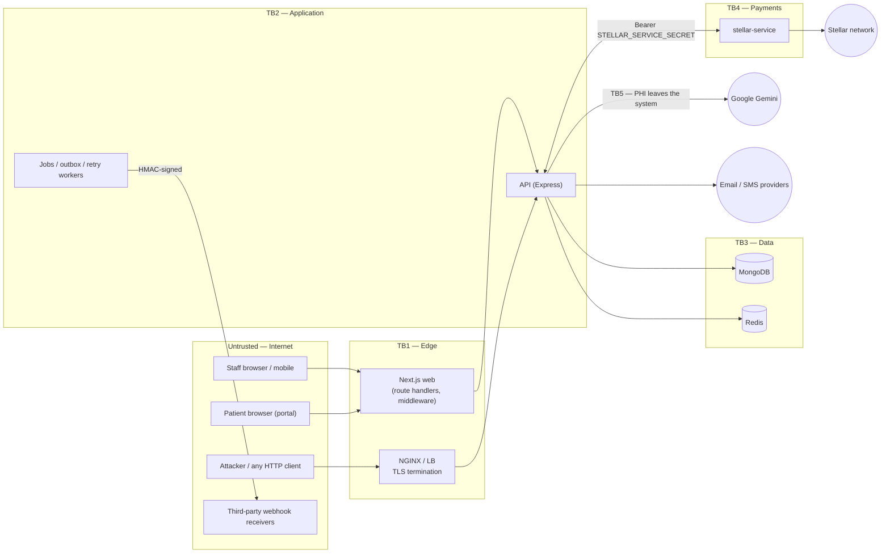
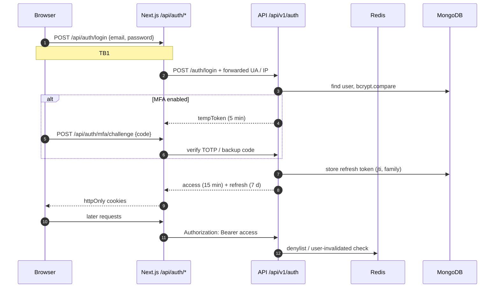
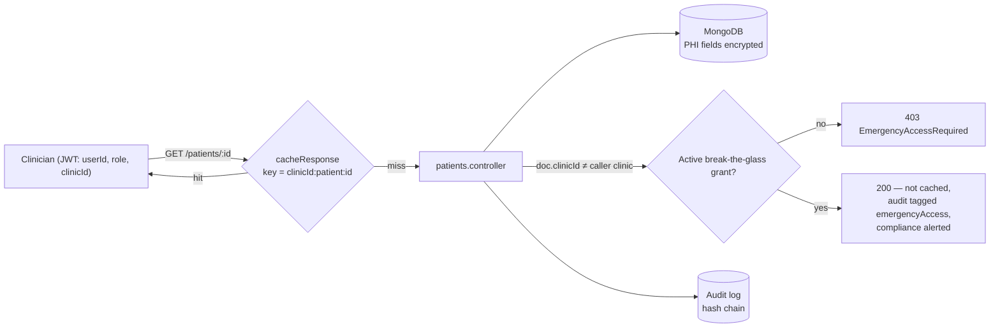
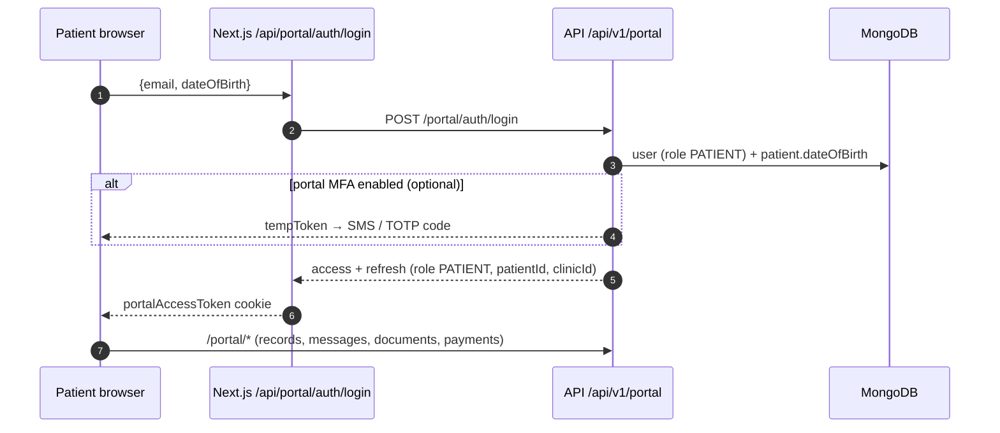
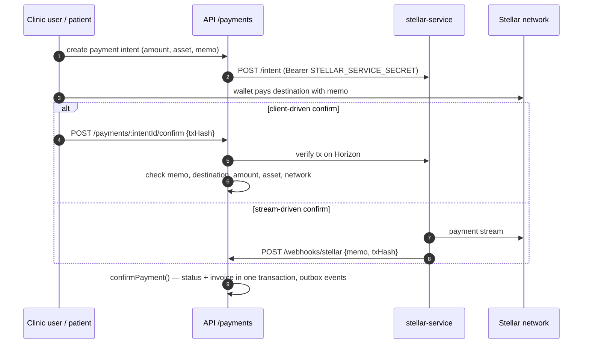
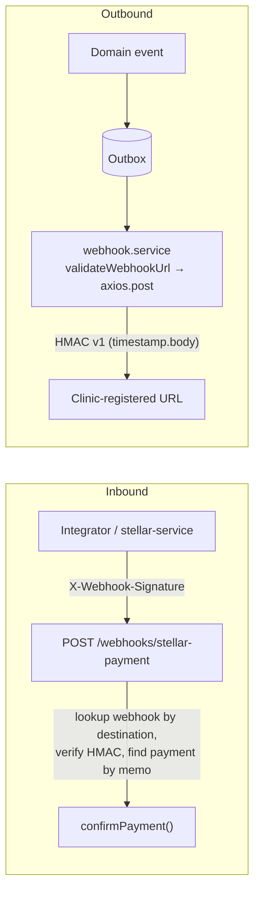
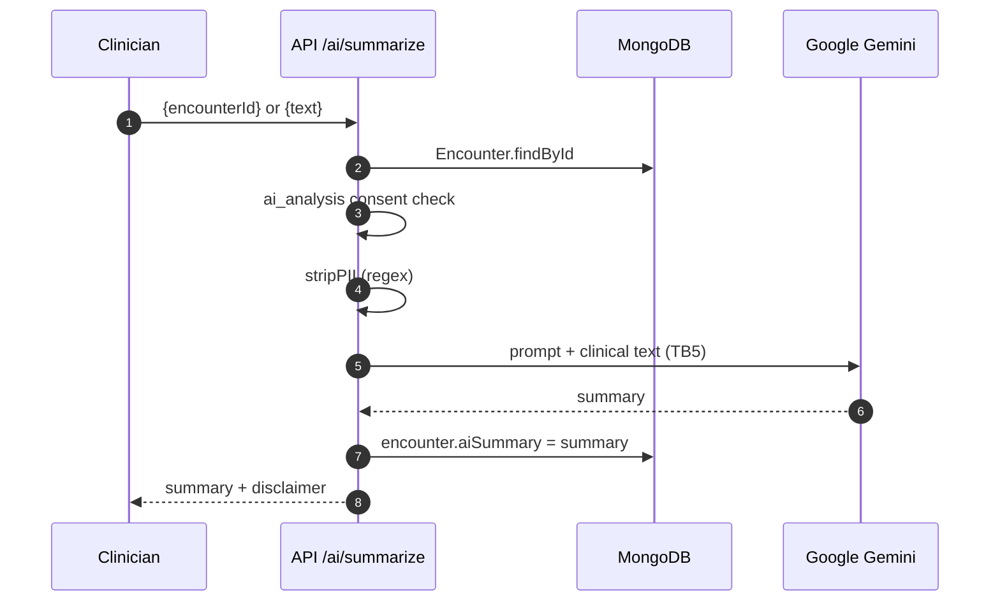

# Threat Model — PHI and Payment Flows

**Method:** STRIDE per trust boundary, risk = Likelihood × Impact  
**Scope:** `apps/api`, `apps/web`, `apps/stellar-service`  
**Related:** [`SECURITY_POLICY.md`](../SECURITY_POLICY.md), [`PENTEST_FINDINGS.md`](../PENTEST_FINDINGS.md), [`PHI_HANDLING_GUIDE.md`](../PHI_HANDLING_GUIDE.md), [ADR-003](../adr/ADR-003-security-architecture.md), [ADR-014](../adr/ADR-014-payment-processing.md)  
**Classification:** CONFIDENTIAL — Internal Use Only

---

## Contents

1. [Purpose and scope](#1-purpose-and-scope)
2. [System context and trust boundaries](#2-system-context-and-trust-boundaries)
3. [Risk rating](#3-risk-rating)
4. [Flow 1 — Staff login and session](#4-flow-1--staff-login-and-session)
5. [Flow 2 — Patient record access](#5-flow-2--patient-record-access)
6. [Flow 3 — Patient portal](#6-flow-3--patient-portal)
7. [Flow 4 — Stellar payments](#7-flow-4--stellar-payments)
8. [Flow 5 — Webhooks](#8-flow-5--webhooks)
9. [Flow 6 — AI summary](#9-flow-6--ai-summary)
10. [Risk register](#10-risk-register)
11. [Follow-up issues](#11-follow-up-issues)
12. [Maintenance and review](#12-maintenance-and-review)

---

## 1. Purpose and scope

The pentest documents record point-in-time findings. This model is the systematic view used to
prioritise security work: for each flow that touches PHI or money it identifies the trust
boundaries, applies STRIDE to each, maps every threat to the control that exists in code today and
rates what is left.

**Assets**

| ID | Asset | Where it lives |
|----|-------|----------------|
| A1 | PHI — demographics, encounters, labs, medications, notes | MongoDB (`patients`, `encounters`, …), Redis response cache |
| A2 | Credentials — passwords, TOTP secrets, refresh tokens, API keys | MongoDB (`users`, `refreshtokens`, `apikeys`) |
| A3 | Session tokens — access JWT, refresh JWT, temp MFA JWT | Browser httpOnly cookies, mobile secure storage |
| A4 | Payment state — payment intents, invoices, confirmations | MongoDB (`paymentrecords`, `invoices`) |
| A5 | Stellar signing keys | stellar-service environment / cold-wallet store |
| A6 | Audit trail | MongoDB (`auditlogs`, `auditchainheads`), Stellar anchor |
| A7 | Integration secrets — webhook HMAC secrets, `STELLAR_SERVICE_SECRET`, `GEMINI_API_KEY` | MongoDB, environment / Secrets Manager |

**Out of scope:** Kubernetes / cloud infrastructure, the Stellar network and Google Gemini
themselves (treated as external entities), and physical security.

---

## 2. System context and trust boundaries

| Boundary | Crosses from → to | Main concern |
|----------|-------------------|--------------|
| TB1 | Internet → web / API | Identity of the caller; everything before `authenticate` is untrusted |
| TB2 | Authenticated user → another clinic's / patient's data | Authorisation (tenant and role isolation) |
| TB3 | Application → data stores | Data at rest, cache contents, fail-open behaviour |
| TB4 | API ↔ stellar-service ↔ Stellar | Integrity of payment state; key custody |
| TB5 | Application → third parties (Gemini, webhook receivers, email/SMS) | PHI disclosure, SSRF |

---

## 3. Risk rating

**Likelihood (L)**: 1 Rare · 2 Unlikely · 3 Possible · 4 Likely · 5 Almost certain (exploitable by an
unauthenticated client with no special knowledge).

**Impact (I)**: 1 Negligible · 2 Minor · 3 Moderate (single-record PHI, small financial loss) ·
4 Major (multi-record PHI, invoice fraud) · 5 Severe (clinic-wide PHI breach, loss of funds, HIPAA
reportable breach).

**Risk = L × I**

| Score | Rating | Expectation |
|-------|--------|-------------|
| 15–25 | 🔴 High | Follow-up issue opened; fix before next release |
| 8–14 | 🟠 Medium | Scheduled in backlog |
| 1–7 | 🟢 Low | Accepted / monitored |

**Status**: ✅ Mitigated (control exists and is tested) · 🟡 Partial · 🔴 Open.

STRIDE categories: **S**poofing · **T**ampering · **R**epudiation · **I**nformation disclosure ·
**D**enial of service · **E**levation of privilege.

---

## 4. Flow 1 — Staff login and session

| ID | STRIDE | Threat | Existing controls | L | I | Risk | Status |
|----|--------|--------|-------------------|---|---|------|--------|
| AUTH-01 | S | Credential stuffing / brute force on `/auth/login` | `authLimiter` 5 req / 15 min per IP (`middlewares/rate-limit.middleware.ts`); per-account lockout + locked email (`auth.controller.ts`); bcrypt | 3 | 4 | 12 🟠 | 🟡 Partial — per-IP limit is weak against distributed attacks |
| AUTH-02 | S | Phished password reused by attacker | MFA mandatory for privileged roles (ADR-017) with 7-day grace; new-device / new-country alert with "This wasn't me" revoke (`login-alert.service.ts`) | 3 | 4 | 12 🟠 | 🟡 Partial — DOCTOR / NURSE can log in without MFA during grace period |
| AUTH-03 | S | JWT forgery / algorithm confusion | HS256 pinned, `iss`, `aud`, `exp`, `jti` validated (`jwt-claim-validator.ts`, `token.service.ts`); separate secrets for access / refresh / temp tokens | 1 | 5 | 5 🟢 | ✅ |
| AUTH-04 | S | Stolen refresh token replayed | Rotation with family revocation on reuse (`/auth/refresh`); httpOnly + `Secure` cookies in prod | 2 | 4 | 8 🟠 | ✅ |
| AUTH-05 | I | Account enumeration via login timing (unknown email returns before `bcrypt.compare`) | Same generic error message | 3 | 2 | 6 🟢 | 🔴 Open — accepted, low impact |
| AUTH-06 | T | CSRF on cookie-authenticated web routes | Double-submit `csrf-token` cookie, `SameSite=strict` (`csrf.middleware.ts`); session cookies `SameSite=lax` | 2 | 3 | 6 🟢 | ✅ |
| AUTH-07 | E | Revoked token still accepted when Redis is unavailable — `cache.get` returns `null`, so denylist and logout-all checks fail **open** (`services/token-denylist.service.ts`) | 15-min access-token lifetime bounds the window | 2 | 4 | 8 🟠 | 🔴 Open |
| AUTH-08 | R | User denies a sign-in or session action | Audit log entries for login / lockout, hash-chained and nightly-verified (`audit-chain.service.ts`) | 2 | 3 | 6 🟢 | ✅ |
| AUTH-09 | D | Attacker locks out a known clinician by failing logins on purpose | Lock is time-boxed; admin `/auth/unlock` | 3 | 3 | 9 🟠 | 🟡 Partial |

---

## 5. Flow 2 — Patient record access

| ID | STRIDE | Threat | Existing controls | L | I | Risk | Status |
|----|--------|--------|-------------------|---|---|------|--------|
| PHI-01 | E | Clinician reads another clinic's patient by ID | Clinic check + time-limited break-the-glass grant, compliance review queue (`emergency-access/*`); list endpoints scoped to caller clinic (FIND-004) | 2 | 5 | 10 🟠 | ✅ |
| PHI-02 | E | **Patient-portal token used against staff routes.** Portal tokens are signed with the same secret / audience as staff tokens and carry the patient's `clinicId`. `GET /patients`, `GET /patients/:id` and other read routes only check `authenticate` + clinic scope, not role, so a `PATIENT` can read every patient in their clinic | Clinic scoping only | 4 | 5 | **20 🔴** | 🔴 Open |
| PHI-03 | I | Stale or cross-user data served from the Redis response cache | Cache key includes `clinicId`; grant-served records skip the cache; mutations invalidate | 2 | 4 | 8 🟠 | 🟡 Partial — repeat views within TTL are not individually audited |
| PHI-04 | I | Database dump / backup theft | Field-level AES-256-GCM PHI encryption (`DATA_ENCRYPTION_AT_REST.md`), encrypted backups | 2 | 5 | 10 🟠 | ✅ |
| PHI-05 | T | Record modified without trace | Mutation audit middleware; audit entries hash-chained per clinic, nightly verification, optional Stellar anchor (`audit-chain.*`) | 2 | 4 | 8 🟠 | ✅ |
| PHI-06 | R | Clinician denies viewing a record | `PATIENT_VIEW` audit entry with user, clinic, request id; chain makes deletion detectable | 2 | 3 | 6 🟢 | ✅ |
| PHI-07 | T | NoSQL operator injection in query / body | `express-mongo-sanitize`, Zod validation (`validate.middleware.ts`), ObjectId schema | 1 | 5 | 5 🟢 | ✅ |
| PHI-08 | D | Bulk export / search used to scrape or exhaust the API | `generalLimiter`, `exportRateLimit`, per-resource limits (`PER_RESOURCE_RATE_LIMITING.md`) | 2 | 3 | 6 🟢 | ✅ |

---

## 6. Flow 3 — Patient portal

| ID | STRIDE | Threat | Existing controls | L | I | Risk | Status |
|----|--------|--------|-------------------|---|---|------|--------|
| POR-01 | S | **Account takeover with email + date of birth.** Both are low-entropy and frequently known or public; portal MFA is opt-in | `generalLimiter` only — `/portal` is not behind `authLimiter`, and portal login has no failed-attempt lockout | 4 | 4 | **16 🔴** | 🔴 Open |
| POR-02 | E | Patient reads another patient's data through `/portal/*` | Portal handlers derive `patientId` from the token, never from the request | 2 | 4 | 8 🟠 | ✅ |
| POR-03 | E | Patient token accepted on staff API routes | See PHI-02 | — | — | — | 🔴 Open (PHI-02) |
| POR-04 | I | PHI in notification emails — the message-reply email includes the message subject and body (`portal.controller.ts`) | TLS to provider | 3 | 3 | 9 🟠 | 🔴 Open |
| POR-05 | T | HTML injection in notification emails (subject / body interpolated without escaping) | Message author is authenticated staff | 2 | 3 | 6 🟢 | 🔴 Open — accepted |
| POR-06 | D | SMS OTP abuse (toll fraud, provider rate limits) | Queued SMS sending (`sms-queue.ts`), `generalLimiter` | 3 | 2 | 6 🟢 | 🟡 Partial |
| POR-07 | R | Patient denies sending a message or consent | Audit log, consent records with timestamps | 2 | 2 | 4 🟢 | ✅ |

---

## 7. Flow 4 — Stellar payments

| ID | STRIDE | Threat | Existing controls | L | I | Risk | Status |
|----|--------|--------|-------------------|---|---|------|--------|
| PAY-01 | S/T | **Forged payment confirmation.** `POST /webhooks/stellar` is unauthenticated and calls `confirmPayment()` for any pending payment matching `memo`, without verifying the transaction on-chain. stellar-service sends `Authorization: Bearer <secret>`, but the API never checks it. The CSRF double-submit check does not help: a non-browser client sets both the cookie and the header itself | None effective | 4 | 5 | **20 🔴** | 🔴 Open |
| PAY-02 | T | Underpayment / wrong asset / wrong network on client confirm | `/payments/:intentId/confirm` validates memo, destination, amount (7 dp), asset and network passphrase | 2 | 4 | 8 🟠 | ✅ |
| PAY-03 | T | Double confirmation / race | Status-filtered `findOneAndUpdate` in a transaction (`payment-confirmation.service.ts`); idempotency keys (`idempotency.test.ts`) | 2 | 3 | 6 🟢 | ✅ |
| PAY-04 | S | Caller of stellar-service impersonates the API | Static bearer `STELLAR_SERVICE_SECRET`; compared with `!==` (not constant-time) in `stellar-service/src/index.ts`; no rotation / mTLS | 2 | 5 | 10 🟠 | 🟡 Partial |
| PAY-05 | I | Signing key disclosure. `POST /cold-wallet/keys` accepts raw secret keys over HTTP; log redaction covers only the `Authorization` header | Secret-protected route; internal network | 2 | 5 | 10 🟠 | 🟡 Partial |
| PAY-06 | E | Accidental mainnet use / oversized transfer | `assertMainnetSafety` (`MAINNET_CONFIRMED`), `assertTransactionLimit`, dry-run mode (`guards.ts`), fee budget middleware | 1 | 5 | 5 🟢 | ✅ |
| PAY-07 | D | Horizon outage / backlog stalls confirmations | Circuit breaker, reconciliation job, payment retry service, expiration job | 3 | 3 | 9 🟠 | ✅ |
| PAY-08 | R | Clinic disputes a payment | On-chain tx hash stored with record; dispute workflow; audit log | 2 | 3 | 6 🟢 | ✅ |
| PAY-09 | I | Unauthenticated `stellar-service` monitoring routes (`/monitor/*`, `/monitor/alerts/history`, `/network`) leak operational data | Internal network only | 2 | 2 | 4 🟢 | 🔴 Open — accepted |

---

## 8. Flow 5 — Webhooks

| ID | STRIDE | Threat | Existing controls | L | I | Risk | Status |
|----|--------|--------|-------------------|---|---|------|--------|
| WH-01 | S | Forged inbound webhook | HMAC-SHA256 with `timingSafeEqual` (`webhook.service.ts`); exact-match lookup (FIND-005) | 2 | 4 | 8 🟠 | ✅ |
| WH-02 | E | **Cross-tenant confirmation.** After the HMAC check on `/webhooks/stellar-payment`, the payment is found by `memo` only, not scoped to the webhook's clinic, so a clinic holding a valid secret can confirm or fail another clinic's pending payment | HMAC proves only the sender's own webhook | 3 | 5 | **15 🔴** | 🔴 Open |
| WH-03 | T | Replay of a captured inbound webhook | Inbound path uses the legacy bare-body HMAC (no timestamp); outbound uses v1 timestamped signatures (`webhook-signature.ts`) | 3 | 3 | 9 🟠 | 🔴 Open |
| WH-04 | I/E | **SSRF from outbound delivery.** `validateWebhookUrl` (`utils/url-validator.ts`) checks the hostname string only: DNS names resolving to private / metadata IPs, bracketed IPv6 (`[::1]`) and HTTP redirects (axios follows them by default) all bypass it | HTTPS-only in production; literal private-IP blocklist | 3 | 5 | **15 🔴** | 🔴 Open |
| WH-05 | I | PHI over-shared to third-party receivers | Event templates (`webhook-template.ts`); clinic admin opts in per event | 2 | 4 | 8 🟠 | 🟡 Partial |
| WH-06 | D | Slow / failing receiver exhausts workers | Per-webhook rate limiter, retry worker with backoff, response body cap | 2 | 2 | 4 🟢 | ✅ |
| WH-07 | D | Malformed signature header causes 500 (`timingSafeEqual` throws on length mismatch) | Error middleware | 3 | 1 | 3 🟢 | 🔴 Open — accepted |

---

## 9. Flow 6 — AI summary

| ID | STRIDE | Threat | Existing controls | L | I | Risk | Status |
|----|--------|--------|-------------------|---|---|------|--------|
| AI-01 | E/I | **Missing authorisation on `/ai/summarize`.** The route has `authenticate` but no role guard, and loads the encounter with `findById` without a clinic filter. Any authenticated user (including `PATIENT`) who knows an encounter id can generate a summary of it, and the summary overwrites `encounter.aiSummary`. `/ai/insights`, `/ai/health-trends` and `/ai/interpret-labs` also lack role guards | Consent check scoped to caller's clinic | 3 | 5 | **15 🔴** | 🔴 Open |
| AI-02 | I | **PHI disclosed to an external processor.** `stripPII` only removes phone, email, SSN, US-format dates and 5-digit numbers; names, MRNs, addresses and free-text identifiers in notes reach Gemini. The raw-`text` path skips the consent check entirely | `ai_analysis` consent on the encounter path; BAA template (`BAA_TEMPLATE.md`) | 4 | 4 | **16 🔴** | 🟡 Partial |
| AI-03 | T | Prompt injection via clinical notes alters the generated summary | Output labelled with `AI_DISCLAIMER`; clinician review expected | 3 | 3 | 9 🟠 | 🟡 Partial |
| AI-04 | R | Unclear who generated / accepted an AI summary | Request log with encounter id and duration; no audit entry recording the generating user | 3 | 2 | 6 🟢 | 🔴 Open |
| AI-05 | D | Cost / quota exhaustion through repeated summary calls | `generalLimiter` | 3 | 2 | 6 🟢 | 🟡 Partial |
| AI-06 | I | Patient name sent in AI-summary notification email | — | 3 | 2 | 6 🟢 | 🔴 Open — accepted |

---

## 10. Risk register

All 🔴 High risks, followed by open or partial 🟠 Medium risks, sorted by score.

| Rank | ID | Threat | Risk | Status |
|------|----|--------|------|--------|
| 1 | PAY-01 | Unauthenticated `/webhooks/stellar` confirms payments | 20 🔴 | Open |
| 2 | PHI-02 | Portal (`PATIENT`) token reads staff patient routes | 20 🔴 | Open |
| 3 | POR-01 | Portal login by email + DOB, no lockout, MFA optional | 16 🔴 | Open |
| 4 | AI-02 | PHI reaches Gemini; raw-text path bypasses consent | 16 🔴 | Partial |
| 5 | WH-02 | Cross-tenant payment confirmation via inbound webhook | 15 🔴 | Open |
| 6 | WH-04 | SSRF via DNS / redirect in outbound webhooks | 15 🔴 | Open |
| 7 | AI-01 | `/ai/*` routes lack role and clinic checks | 15 🔴 | Open |
| 8 | AUTH-01 | Distributed credential stuffing | 12 🟠 | Partial |
| 9 | AUTH-02 | Password-only login during MFA grace period | 12 🟠 | Partial |
| 10 | PAY-04 | Static, non-constant-time stellar-service secret | 10 🟠 | Partial |
| 11 | PAY-05 | Raw signing keys accepted over HTTP | 10 🟠 | Partial |
| 12 | AUTH-09 | Targeted lockout of clinicians | 9 🟠 | Partial |
| 13 | POR-04 | PHI in portal notification emails | 9 🟠 | Open |
| 14 | WH-03 | Inbound webhook replay | 9 🟠 | Open |
| 15 | AI-03 | Prompt injection in clinical notes | 9 🟠 | Partial |
| 16 | AUTH-07 | Token denylist fails open without Redis | 8 🟠 | Open |
| 17 | PHI-03 | Cache hits not individually audited | 8 🟠 | Partial |
| 18 | WH-05 | PHI over-shared to webhook receivers | 8 🟠 | Partial |

---

## 11. Follow-up issues

One issue per unmitigated High risk. Issue numbers are filled in once filed.

| Risk | Proposed issue title | Suggested fix |
|------|----------------------|---------------|
| PAY-01 | `[Security] Authenticate /webhooks/stellar and verify the transaction on-chain` | Require `STELLAR_SERVICE_SECRET` (constant-time compare) and run the same Horizon verification as `/payments/:intentId/confirm` before `confirmPayment()` |
| PHI-02 | `[Security] Reject PATIENT tokens on staff routes` | Give portal tokens a distinct audience (or deny `PATIENT` in a router-level guard on non-portal routes) and add `requireStaff` to patient read routes |
| POR-01 | `[Security] Harden patient portal login` | Apply `authLimiter` and per-account lockout to `/portal/auth/login`; move to magic-link or password + mandatory OTP |
| AI-02 | `[Security] De-identify AI prompts and require consent on every path` | Build prompts from an allow-list of clinical fields instead of regex stripping; drop or consent-gate the raw `text` path; confirm a Gemini BAA is in place |
| WH-02 | `[Security] Scope inbound webhook payment lookup to the webhook's clinic` | Filter `PaymentRecordModel.findOne` by `clinicId: webhook.clinicId` and destination |
| WH-04 | `[Security] Resolve-and-pin outbound webhook targets to block SSRF` | Resolve DNS, reject private / link-local / metadata ranges (IPv4 + IPv6), connect to the resolved IP, set `maxRedirects: 0` |
| AI-01 | `[Security] Add role guards and clinic scoping to /ai routes` | `requireRoles(...)` on every `/ai/*` route; load encounters / patients with `{ _id, clinicId }` |

Medium risks are tracked in the backlog and re-rated at the next review.

---

## 12. Maintenance and review

- **When to update:** any change that adds a trust boundary (new external service, new public
  route, new token type), changes authentication / authorisation, or touches PHI or payment
  storage. Reference the threat IDs touched in the PR description.
- **Cadence:** re-rate every quarter and after each penetration test; close rows only when the
  control is merged **and** covered by a test.
- **Diagrams:** Mermaid sources live inline here; system-level diagrams are in
  [`docs/diagrams/`](../diagrams/).

### Review sign-off

| Date | Reviewer (maintainer) | Scope reviewed | Outcome |
|------|-----------------------|----------------|---------|
| | | Full document | Pending |
